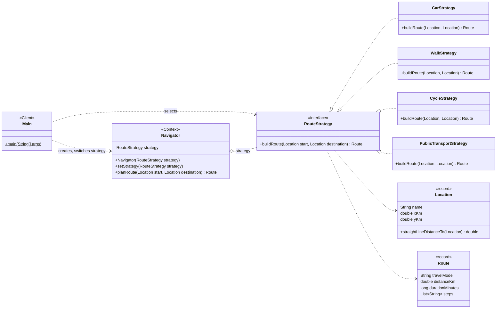

# Assignment #5: Strategy Pattern

**Course:** ShP-2216 Software Design Patterns
**Student:** Alikhan Yertaiuly
**Topic:** Navigation / Route Planning (Option A)

## 1. Introduction

I chose the suggested topic: a navigation app that plans a route from a start point to a destination.
The algorithm that changes is *how the route is built*, which depends on the way of travelling. Each
mode has its own detour factor (how much longer than a straight line the real path is), average speed
and instructions:

| Strategy | Detour factor | Speed | Extra |
|---|---|---|---|
| `CarStrategy` | 1.3 | 50 km/h | follows roads |
| `WalkStrategy` | 1.1 | 5 km/h | pedestrian paths |
| `CycleStrategy` | 1.15 | 15 km/h | bike lanes |
| `PublicTransportStrategy` | 1.4 | 25 km/h | 7 min waiting time |

Without the pattern, one `Navigator` class would need a `switch` on the travel mode and would have to
change every time a mode is added. With Strategy, every algorithm is its own class behind the
`RouteStrategy` interface, and the `Navigator` simply delegates to the one it currently holds. The
strategy can be replaced at runtime with `setStrategy(...)`.

## 2. UML Class Diagram



**Roles**

- **Strategy interface:** `RouteStrategy`
- **Concrete strategies:** `CarStrategy`, `WalkStrategy`, `CycleStrategy`, `PublicTransportStrategy`
- **Context:** `Navigator`
- **Client:** `Main`

## 3. Clean Code

The principles come from Clean Code, Chapter 10 (Classes) and Chapter 11 (Systems), plus Chapter 9
(Unit Tests) and the chapter on names.

### 3.1 Polymorphism instead of conditional logic

*Before:* every new mode forces a change inside `Navigator`.

```java
public Route planRoute(String mode, Location start, Location destination) {
    double distance = start.straightLineDistanceTo(destination);
    if (mode.equals("car")) {
        return new Route("Car", distance * 1.3, Math.round(distance * 1.3 / 50 * 60), carSteps);
    } else if (mode.equals("walk")) {
        return new Route("Walk", distance * 1.1, Math.round(distance * 1.1 / 5 * 60), walkSteps);
    } else if (mode.equals("cycle")) {
        // ...
    }
    throw new IllegalArgumentException(mode);
}
```

*After:* `Navigator` has no `if`/`switch`; the right algorithm is chosen by the object it holds.

```java
public Route planRoute(Location start, Location destination) {
    return strategy.buildRoute(start, destination);
}
```

### 3.2 Meaningful, intention-revealing names

Class names say which algorithm they contain (`CarStrategy`, `WalkStrategy`), and constants replace
magic numbers, so the reader does not need to guess what `1.3` or `50` means.

*Before:* `Math.round(d * 1.3 / 50 * 60)`

*After:*

```java
private static final double ROAD_DETOUR_FACTOR = 1.3;
private static final double AVERAGE_SPEED_KMH = 50.0;
...
double distanceKm = start.straightLineDistanceTo(destination) * ROAD_DETOUR_FACTOR;
long minutes = Math.round(distanceKm / AVERAGE_SPEED_KMH * 60);
```

### 3.3 Single Responsibility Principle (Ch. 10)

*Before:* one `Navigator` class knew the rules of every travel mode, so it had many reasons to change
(a new speed for bikes, a new car rule, a new mode...).

*After:* each strategy has exactly one reason to change: its own algorithm.

```java
public class WalkStrategy implements RouteStrategy {
    private static final double PEDESTRIAN_PATH_FACTOR = 1.1;
    private static final double AVERAGE_SPEED_KMH = 5.0;

    @Override
    public Route buildRoute(Location start, Location destination) { ... }
}
```

The classes are small (about 25 lines), in line with "classes should be small".

### 3.4 Context stays algorithm-agnostic (Ch. 10, Isolating from Change)

`Navigator` depends only on the `RouteStrategy` abstraction. It has no imports of any concrete
strategy, so changes to `CarStrategy` or `CycleStrategy` cannot break it.

```java
import kz.aitu.navigation.strategy.RouteStrategy;   // the only strategy import

public class Navigator {
    private RouteStrategy strategy;
    ...
}
```

### 3.4a Separate constructing from using (Ch. 11, Systems)

Creating the strategies and choosing one happens in one place, `Main`. `Navigator` receives its
strategy from outside (dependency injection through the constructor and `setStrategy`) instead of
building it with `new` internally.

```java
Navigator navigator = new Navigator(availableModes.get("car"));
navigator.setStrategy(availableModes.get("walk"));
```

### 3.5 Open for extension, closed for modification (Ch. 10, Organizing for Change)

`PublicTransportStrategy` was added in its own commit after everything else worked. The only change
in existing files was one line in `Main` that registers it:

```java
modes.put("transit", new PublicTransportStrategy());
```

`Navigator`, `RouteStrategy` and the other three strategies were not touched.

### 3.6 Clean unit tests (Ch. 9)

`NavigatorTest` follows the F.I.R.S.T. rules: tests are **F**ast (pure calculations),
**I**ndependent (no shared state), **R**epeatable (no network or time), **S**elf-validating (they
print PASS/FAIL and set the exit code) and written **T**imely, next to the production code. Each test
checks one concept, with names that describe the behaviour:

```java
private static void strategyCanBeSwitchedAtRuntime() {
    Navigator navigator = new Navigator(new CarStrategy());
    navigator.setStrategy(new WalkStrategy());
    assertEquals("Walk", navigator.planRoute(START, DESTINATION).travelMode());
}
```

One test uses a lambda as a brand-new strategy to prove that `Navigator` works with strategies it has
never seen.

## 4. Conclusion

The pattern added classes: one interface and four strategies instead of a single method with a
`switch`. In exchange, the `Navigator` is five lines long, new travel modes need no change to
existing code, every algorithm is tested in isolation, and the mode can be switched while the
program is running. For two modes this would be too much structure; for a family of algorithms that
keeps growing (I already added a fourth one), the extra classes pay for themselves.

## 5. GitHub Repository

<https://github.com/YOUR-USERNAME/route-planner-strategy>
